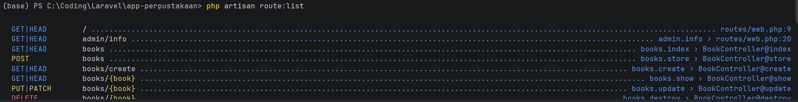
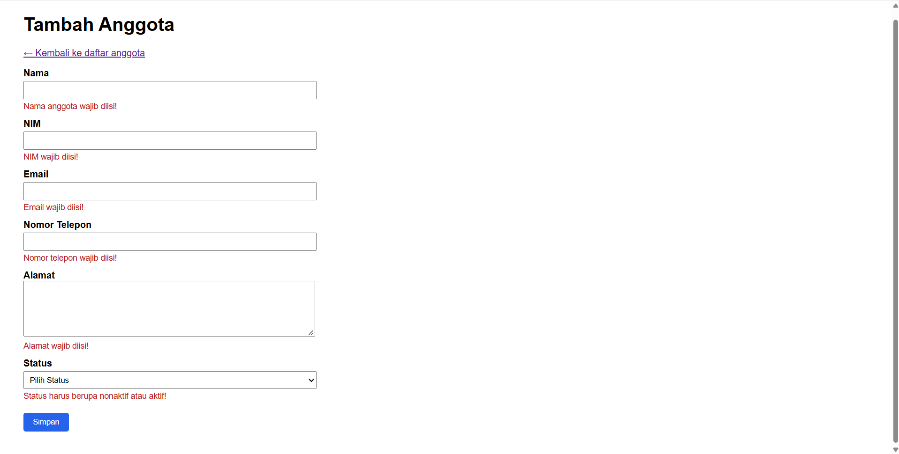
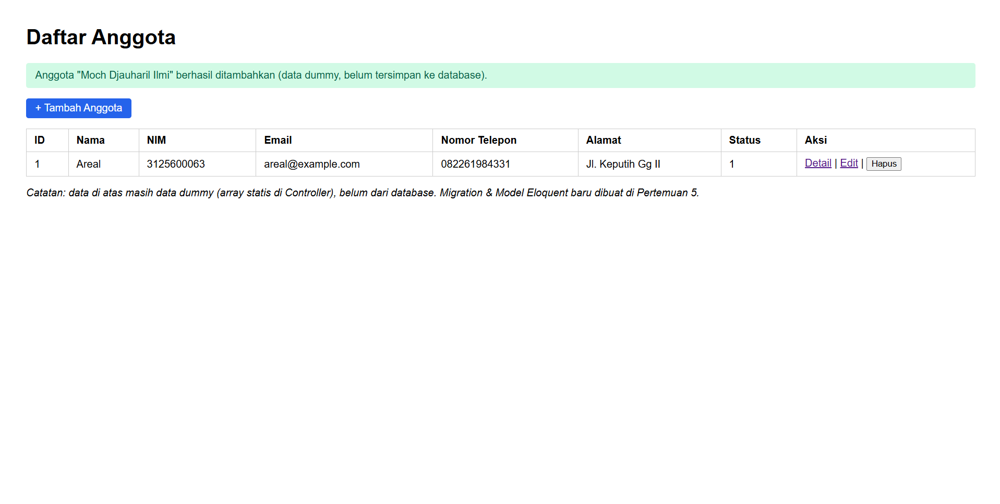

# Aplikasi Perpustakaan

Aplikasi Perpustakaan adalah aplikasi web untuk membantu pengelolaan data perpustakaan secara lebih terstruktur. Tujuannya adalah memudahkan pengembangan fitur seperti pencatatan koleksi buku, data pengguna, serta proses peminjaman dan pengembalian buku.

Aplikasi ini dibangun dengan Laravel dan menyediakan dua antarmuka sekaligus:

- **Web Blade** untuk petugas dan admin (dashboard, CRUD buku/kategori/anggota, peminjaman, laporan).
- **REST API** (`/api/books`, `/api/members`, `/api/loans`, `/api/stats`) yang mengembalikan JSON dan bisa dikonsumsi klien lain, termasuk oleh halaman Blade aplikasi ini sendiri lewat Laravel HTTP Client.

## Kebutuhan

- PHP 8.2 atau lebih baru beserta ekstensi yang dibutuhkan Laravel
- Composer
- Node.js dan npm
- Database (PostgreSQL/MySQL/SQLite) sesuai konfigurasi `.env`

## Clone Repository

```bash
git clone <url-repository> app-perpustakaan
cd app-perpustakaan
```

## Install Dependency

```bash
composer install
npm install
npm run build
```

## Setup `.env`

```bash
cp .env.example .env
php artisan key:generate
```

Sesuaikan koneksi database pada `.env` (misalnya `DB_CONNECTION`, `DB_HOST`, `DB_PORT`, `DB_DATABASE`, `DB_USERNAME`, `DB_PASSWORD`).

Selain itu, pastikan dua variabel berikut ada di `.env`:

```env
APP_FAKER_LOCALE=id_ID

# Instance kedua `php artisan serve` khusus panggilan API internal
# (dipakai DashboardController dan LoanController@report).
INTERNAL_API_URL=http://127.0.0.1:8011
```

`INTERNAL_API_URL` wajib menunjuk ke port yang **berbeda** dari server utama. Nilainya dibaca lewat `config/services.php` (`internal_api.base_url`).

## Migrate & Seed Database

```bash
php artisan migrate:fresh --seed
```

Perintah ini membuat ulang seluruh tabel lalu mengisi data demo secara berurutan: `UserSeeder`, `CategorySeeder`, `BookSeeder` (20 buku), `MemberSeeder` (15 anggota), dan `LoanSeeder` (10 transaksi peminjaman).

Akun demo hasil seeding:

| Email | Password | Role |
| --- | --- | --- |
| `admin@pens.ac.id` | `password` | admin |
| `petugas1@pens.ac.id` | `password` | petugas |
| `petugas2@pens.ac.id` | `password` | petugas |

## Menjalankan Dua Server

Halaman Dashboard (`/`) dan Laporan Peminjaman (`/loans/report`) mengambil datanya lewat HTTP ke API aplikasi sendiri. Karena `php artisan serve` hanya memproses satu request pada satu waktu, memanggil balik ke port yang sama akan menyebabkan *deadlock* (halaman menggantung). Jalankan **dua** instance server di terminal terpisah:

```bash
# Terminal 1 - server utama untuk browser
php artisan serve --port=8000

# Terminal 2 - khusus menerima panggilan API internal
php artisan serve --port=8011
```

Buka `http://127.0.0.1:8000`, login dengan salah satu akun demo di atas, lalu akses Dashboard, Buku, Anggota, Peminjaman, dan Laporan.

Jika server port `8011` dimatikan, Dashboard tetap tampil dengan statistik `0` dan tabel laporan kosong (bukan error 500) - perilaku ini disengaja lewat `try/catch ConnectionException`.

## Endpoint API

| Method | Endpoint | Keterangan |
| --- | --- | --- |
| GET | `/api/books` | Daftar buku (paginated) |
| GET | `/api/books/{id}` | Detail buku |
| POST | `/api/books` | Tambah buku |
| PUT | `/api/books/{id}` | Ubah buku |
| DELETE | `/api/books/{id}` | Hapus buku |
| GET | `/api/members` | Daftar anggota (paginated) |
| GET | `/api/members/{id}` | Detail anggota |
| GET | `/api/loans` | Daftar peminjaman (paginated) |
| POST | `/api/loans` | Buat peminjaman |
| PUT | `/api/loans/{id}/kembalikan` | Proses pengembalian |
| GET | `/api/stats` | Statistik ringkas untuk Dashboard |

Contoh pengujian dari terminal:

```bash
curl http://127.0.0.1:8011/api/stats
```

## Pemahaman MVC
### Model
`Model adalah bagian yang mengelola data dan aturan bisnis aplikasi, misalnya data pengguna atau buku di database.`
### View
`View adalah tampilan yang dilihat pengguna dan bertugas menyajikan data dengan jelas.`
### Controller
`Controller menjadi penghubung yang menerima permintaan, memprosesnya melalui Model, lalu menentukan View atau respons yang dikembalikan.`

## Dokumentasi
### Screenshot `php artisan route:list`

### Screenshot `form /members/create setelah submit kosong`

### Screenshot `form /members/create setelah submit valid`


## Skenario Demo

Urutan langkah demo untuk presentasi/UAS tersedia di [`DEMO.md`](./DEMO.md).
